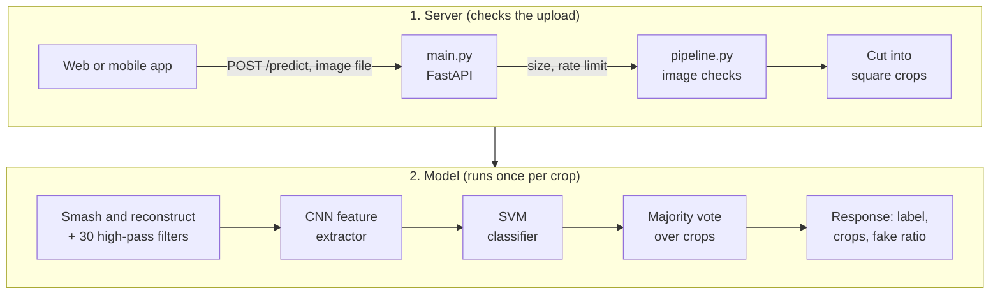

# AI Image Detector

A web and mobile app that tells whether an image is real or AI-generated. The detection is done by a backend API that uses the PatchCraft method where it looks at the fine pixel texture of an image, which tends to differ between camera photos and generated images.

This project is made for UGM's capstone project (Semester 5, UGM). The backend is in this repository under `backend/`. The web and mobile apps are built by team members and call the backend through the API described in [docs/api-contract.md](docs/api-contract.md).

## What it does

- You upload one JPG or PNG image.
- The API answers `real` or `fake` (fake means AI-generated), how many crops of the image it looked at, and what share of those crops were judged fake.
- Images are processed in memory and are never saved.

## Folder structure

```
ai-image-detector/
├── backend/               FastAPI server and the model
│   ├── app/
│   │   ├── main.py                  the API: /health and /predict, error handling, rate limit, CORS
│   │   ├── pipeline.py              loads the model once and turns image bytes into a result
│   │   ├── config.py                paths, limits and settings (no logic)
│   │   └── patchcraft_original.py   the thesis author's model code, kept unchanged
│   ├── weights/                     trained model files (headless_model.pth, svm.pkl)
│   ├── tests/                       sample images for checking the model
│   ├── requirements.txt             packages needed to run the server
│   ├── requirements-dev.txt         the same plus tools for development
│   └── .env.example                 settings you can change
├── docs/
│   └── api-contract.md              what the web and mobile apps can rely on
├── notebooks/                       the original notebook the model code comes from
├── web/                             web app (separate team)
└── mobile/                          mobile app (separate team)
```

## How it works



**The model (PatchCraft).** Each image is cut into square crops. Each crop is split into small 32×32 tiles, and the tiles are sorted by how much the neighbouring pixels differ. The busiest half is shuffled into one "rich texture" image and the calmest half into a "poor texture" image. This removes what is in the picture and keeps only the texture. Thirty high-pass filters bring out the fine pixel noise, a small convolutional neural network (CNN) turns the pair into 32 numbers, and an SVM classifier decides real or fake for that crop. The crops then vote, and the image is `fake` if more than half of the crops say fake.

**The server.** `main.py` receives the upload and rejects bad requests with an error in a fixed shape. `pipeline.py` checks the image (type from the real file bytes, minimum size, maximum pixels, maximum number of crops), then runs the model.

Some design choices, and why:
- **Model in evaluation mode.** The CNN has batch normalisation layers. With one image at a time they must use the statistics stored during training, so the model is switched to evaluation mode (`.eval()`) and run without gradients. Without this, almost every image comes out as fake.
- **Voting rule.** The image is fake if more than half of the crops are fake. An exact tie is settled by the average SVM probability over the crops. The original script truncated the vote (a 0.67 became 0), which we fixed in our own layer.
- **One prediction at a time.** A lock lets only one image through the model at a time, because the model already uses all CPU cores. Requests that wait longer than 30 seconds get a 503. Image checks happen before the lock, so bad uploads are rejected straight away.
- **Original code untouched.** `patchcraft_original.py` is not edited. Our changes live in a subclass in `pipeline.py`.
- **Stateless.** Each request is independent. The only state is the loaded model and the rate-limit counters, both in memory.

## Running the backend

You need Python 3.13 on Windows. These commands are for PowerShell.

1. Go to the backend folder and create a virtual environment:
   ```powershell
   cd backend
   python -m venv .venv
   ```
2. Install the packages:
   ```powershell
   .venv\Scripts\python.exe -m pip install -r requirements.txt
   ```
   The versions are pinned on purpose. In particular, scikit-learn must be exactly 1.6.1 to load the SVM file.
3. Start the server:
   ```powershell
   .venv\Scripts\python.exe -m uvicorn app.main:app --reload
   ```
   Wait for the log line `Model loaded`. The server is at http://localhost:8000.
4. Try it. The interactive docs are at http://localhost:8000/docs, or use curl:
   ```powershell
   curl.exe http://localhost:8000/health
   curl.exe -F "file=@tests/sample_images/ai (1).png" http://localhost:8000/predict
   ```
   The second command returns something like:
   ```json
   {"status": "success", "label": "fake", "crops_analyzed": 1, "fake_crop_ratio": 1.0}
   ```

### Settings

Copy `backend/.env.example` to `backend/.env` to change a setting. The file is not committed.

| Variable       | Default                                         | Meaning                                                  |
|----------------|-------------------------------------------------|----------------------------------------------------------|
| `CORS_ORIGINS` | `http://localhost:3000,http://localhost:5173`   | Web addresses allowed to call the API, comma separated   |
| `RATE_LIMIT`   | `10/minute`                                     | How many requests one client may send                    |
| `LOG_LEVEL`    | `INFO`                                          | `DEBUG`, `INFO`, `WARNING` or `ERROR`                    |

## API

The full description, with every response and error, is in [docs/api-contract.md](docs/api-contract.md). The same information is generated from the code at `/docs` while the server runs.

| Endpoint        | Purpose                                              |
|-----------------|------------------------------------------------------|
| `GET /health`   | Is the server up, and did the model load             |
| `POST /predict` | Upload one image (field name `file`), get the result |

Every error looks like `{"status": "error", "message": "..."}`, with the status codes 400, 413, 429, 500 and 503.

## Credits

The model code and trained weights come from the thesis author's PatchCraft implementation, based on the PatchCraft method for detecting AI-generated images ("PatchCraft: Exploring Texture Patch for Efficient AI-generated Image Detection"). The original notebook is in `notebooks/`.
